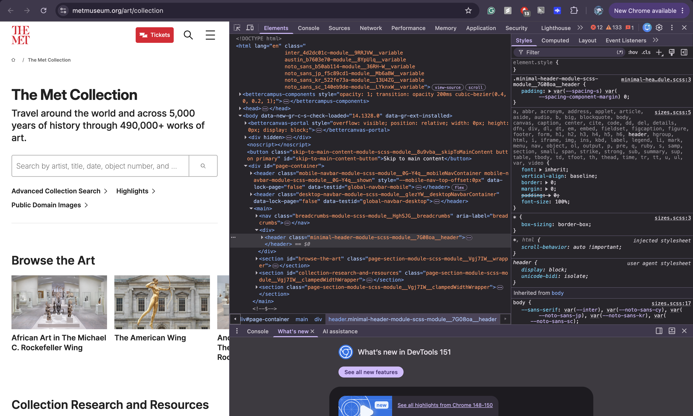

# Source and Style

## Assignment 1

for this assignment I inspected the online website for The Metropolitan Museum of Art.

website url: https://www.metmuseum.org/art/collection

The Met's website contains digital versions of artworks and physical things (like pottery and statues) from many different places and time periods. I chose this website because i thought it was a good example of how a museum can make art available online.

## Web Technologies

I used the Inspect tool in Google Chrome to look at how the Met's website was built.

the website uses HTML to organize the content on each page. In the Elements tab, I could see HTML tags like `div`, `a`, `img`, and also headings. These elements are used to organize text, images, links, and different sections of the website. CSS is also used to control the appearance of the website like fonts, spacing, colors and the layout of the page. I also noticed other types of files and resources besides basic HTML and CSS These included Javascript, image files, font files, and data being loaded from other parts of The Met's website.

## Who Built the Website?

The website was built and is maintained by The Met. The Met has a Digital Department that works on its online content and public-facing digital products.

According to The Met, its Digital Department has included teams focused on collection information, digital content, and product development. The product development team includes people such as developers, designers, and product managers who work on the museum's digital platforms.

The website was not created by only one person. The Met has described its digital work as involving many staff members from different departments. During an earlier redesign of the website, The Met also worked with outside companies called Fantasy Interactive and Velir.

Because many different people work on the collection data, website design, content, and software, I would describe the website as a large collaborative project.

## GitHub

The Met has an official GitHub:

https://github.com/metmuseum

I also found its Open Access repository:

https://github.com/metmuseum/openaccess

The Open Access repository contains data about hundreds of thousands of objects in The Met's collection. I did not find a public repository that clearly contains the complete source code for the current Met website, but the GitHub organization shows that The Met publishes some of its digital resources and collection data publicly.